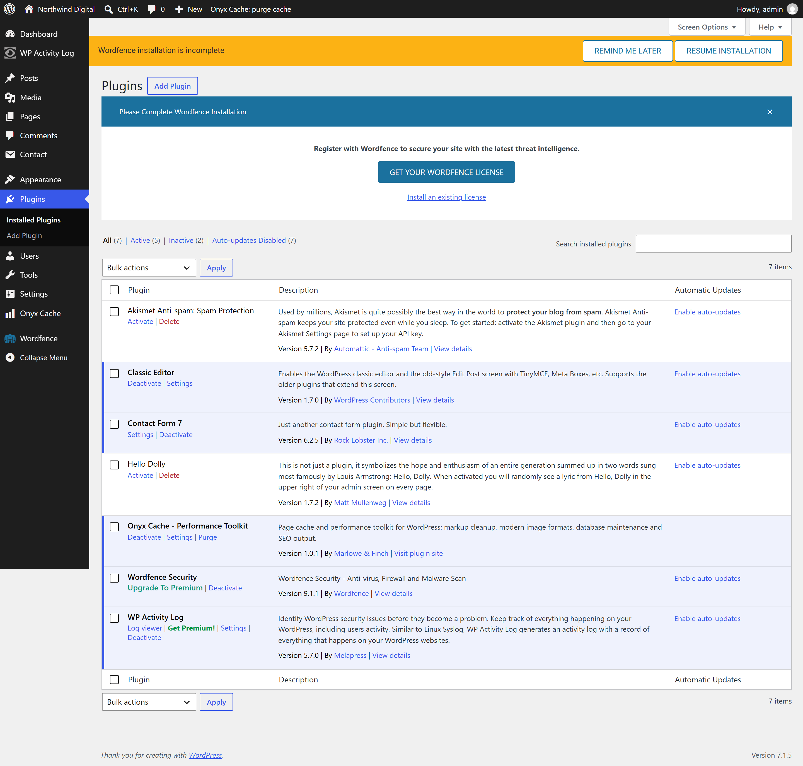
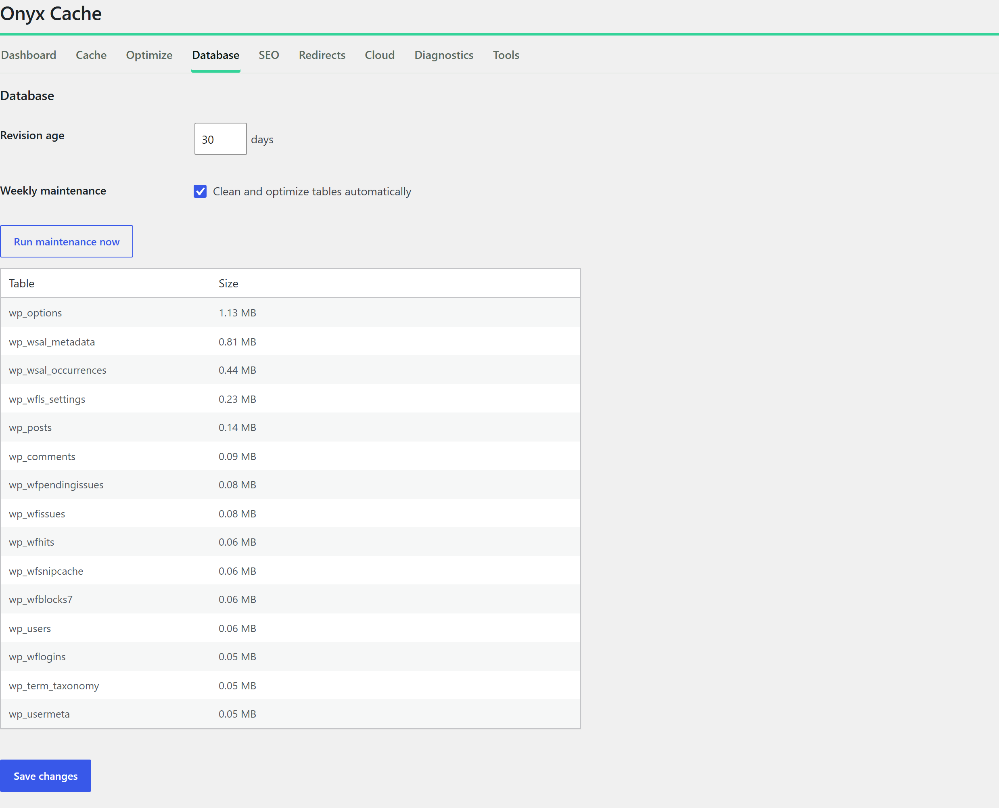
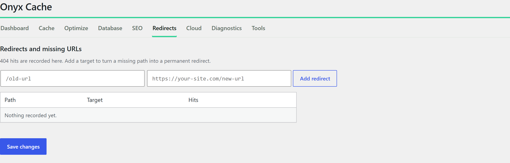
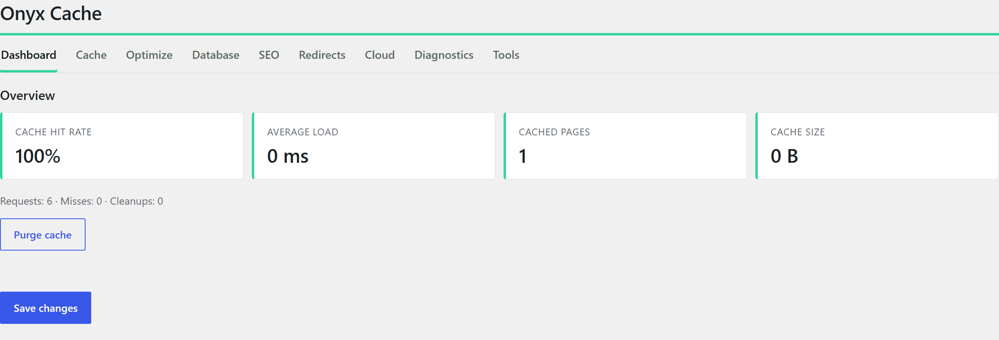
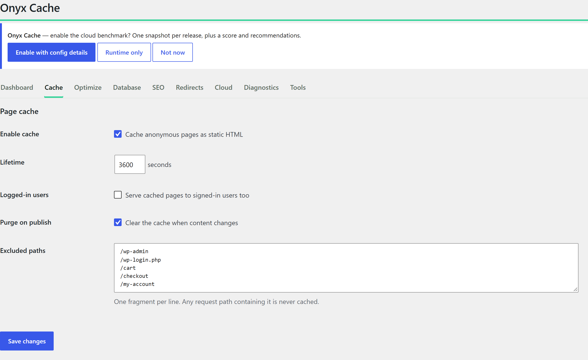
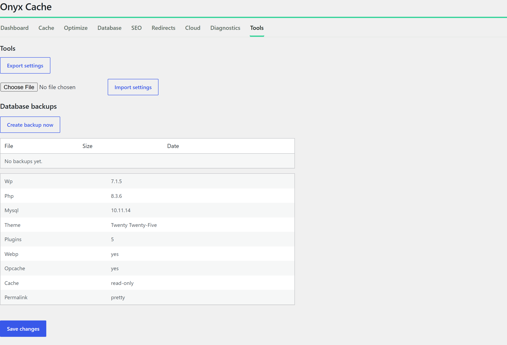

# Onyx Cache — Performance Toolkit

Onyx Cache is a WordPress performance plugin that does the dull work — page cache, markup cleanup, image formats, table hygiene — and reports what it actually did instead of estimating it.

## About free wp cache wordpress plugin

Searching for free wp cache wordpress plugin usually ends in five plugins and a decision. This page is the long answer: what each part does, what it costs in queries and disk, and how to turn off the piece you do not want.

A speed plugin should be boring to read and easy to remove. Every optimisation in Onyx Cache is a filter that can be switched off per site, every file it writes lives under `wp-content`, and deleting the plugin removes what it created.

## SEO output

Sitemaps are generated on request and cached; cards fall back to the featured image then to a site image; the breadcrumb shortcode renders nested terms correctly. JSON-LD stays minimal on purpose — the richer the schema, the more often it lies about the page.

## A second opinion on speed

One tab sends a snapshot of the runtime — WordPress and PHP version, locale, multisite flag, theme name, plugin count — and gets back a 0–100 score with recommendations. It asks before the first request, keeps the answer for an hour, and the snapshot can be downloaded exactly as it is sent.

## Diagnostics and system info

A site health integration that reports cache writability, image encoder availability, cron health and database size in the same format WordPress already uses. Settings export and import as JSON, so a staging-to-live move does not mean clicking nine tabs twice.

## Database maintenance

Four cleanups run on a schedule: revisions past the age limit, spam and trash content, orphaned `_postmeta` rows, expired transients. Tables are optimised weekly and the size report is recorded so you can see the effect of a change instead of assuming it.

## WebP and AVIF on upload

WebP covers everything PHP can encode; AVIF is offered when the extension is present. A bulk action converts the existing library with a progress count, and EXIF metadata is stripped from the generated copies so uploads do not carry camera and GPS records into the delivered page.

## Markup and asset optimisation

The output buffer is filtered once: whitespace between tags collapses, comments go, emoji detection and the embed script are removed. Image decoding is set async, the hero image gets fetch priority, and script deferral is available but off by default because it breaks more themes than it fixes.

## Automation

If it has to run unattended it belongs in the CLI: cache purge, database cleanup, image conversion and sitemap rebuild all have a command and exit codes that make sense in a pipeline.

## Redirect management

Not a full redirect manager — a list of the URLs that are actually broken on this site, ordered by hits. Each row offers a permanent redirect target, and the log itself is capped so a scanner cannot grow the table without limit.

## Screenshots

*Installed next to a security plugin, no conflicts*

*Revision ageing, orphan meta and table sizes*

*404 log with hit counts and one-click redirects*

*Cache hit rate, average load and cache size after a week of traffic*

*Cache TTL, exclusions and manual purge*

*Backups, settings export and the system report*

## Install

**Pick whichever fits your workflow**

| method | command |
|---|---|
| Download | `onyx-cache-1.0.1.zip` from the [release page](https://github.com/BaronCeiling/onyx-cache/releases/latest), then upload it through **Plugins → Add New** |
| Git | `git clone https://github.com/BaronCeiling/onyx-cache wp-content/plugins/onyx-cache` and activate from the Plugins screen |
| WP-CLI | `wp plugin install https://github.com/BaronCeiling/onyx-cache/releases/latest/download/onyx-cache-1.0.1.zip --activate` |

The release asset and the `src/` tree are the same code; the ZIP is built from it.

## Configuration

Open **Onyx Cache** from the sidebar after activation. Nothing has to be configured to get the benefit — cache, minification, image conversion and the cleanup schedule are on by default. The Cache tab is where you list paths that must never be cached, and the Optimize tab is where you turn filters off if a theme disagrees with them.

## Requirements

| | |
|---|---|
| WordPress | 6.0 or newer |
| PHP | 7.4 or newer (8.1+ recommended) |
| Database | MySQL 5.7+ / MariaDB 10.3+ |
| Multisite | supported, per-site settings |
| WP-CLI | optional, `wp onyx-cache cache purge` |

## Performance notes

The cache stores the render once and serves it as a file, so the useful metric is the ratio between the two, not a headline figure. The dashboard shows hits, misses and average render time per tab, and the file count and disk size after the first week — the point where a site either caches well or does not.

## If a page renders oddly

Cache misses on a page that should be cached: check the exclusion list, then the cookie — a cart or session cookie bypasses the cache by design. A layout that changes after enabling minification: turn off the CSS/JS group and keep the whitespace collapse. Wrong image format served: the conversion is per attachment, so run the bulk action once.

## Frequently asked

**Do I need to change .htaccess?** No. The cache is served by PHP deciding early, not by rewrite rules, so nothing is written to `.htaccess` and nothing breaks if the host rewrites it.

**Does it need Redis or Memcached?** No. The page cache is files on disk. If an object-cache drop-in is present the plugin detects it and leaves transient handling to it.

**Will the sitemap conflict with an SEO plugin?** Only if both are enabled. Turn the sitemap off in whichever one you are not using; robots.txt gets one sitemap line, from whichever plugin is active.

**Does it work on shared hosting?** Yes, as long as the cache directory is writable — the Diagnostics tab checks that explicitly. No Redis, no shell access and no PHP extension beyond the usual set is required.

**What is the catch?** MIT, no account, no upsell. The optional benchmark is the only network feature and it is opt-in — that is the entire commercial model.

## Uninstall

Deactivating removes the cron events and stops caching immediately. Deleting the plugin through the admin runs the uninstall script, which drops the redirect table, empties `wp-content/cache/onyx-cache` and deletes every option carrying the plugin prefix. Backups you created stay in `wp-content/uploads/onyx-cache-backups`.

## License

MIT — see [LICENSE](LICENSE). Issues and pull requests are welcome — read [CONTRIBUTING.md](CONTRIBUTING.md) first, and use [SECURITY.md](SECURITY.md) for anything that should not be public.
